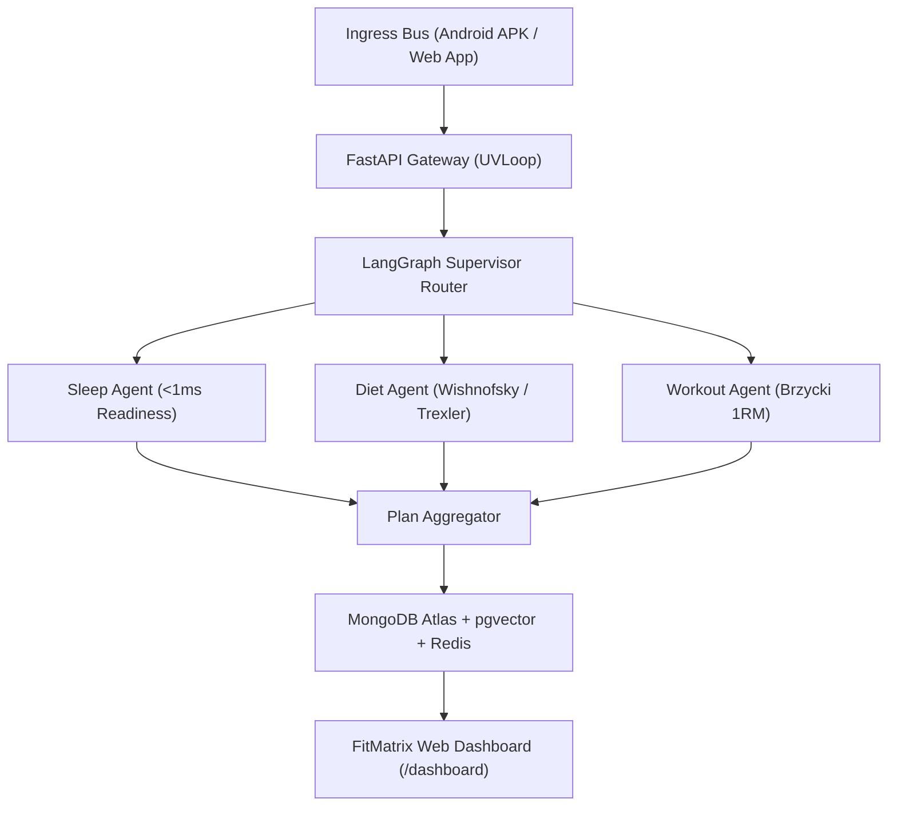

# FitMatrix AI // User Dashboard & Web Platform Architectural Plan

> **Note**: FitMatrix AI couples high-frequency edge biometrics (Android Health Connect API 34+ via POSIX MMKV) with a distributed FastAPI LangGraph multi-agent supervisor DAG. This plan establishes the Next.js web application architecture (`frontend/website`) providing both an academic showcase landing page and a full-featured web companion dashboard.

---

## 1. System Overview & Dual-Universe Philosophy

The web client operates on the same **Dual-Universe** paradigm established in the mobile APK:
1. **Nutrition Universe:** Deterministic thermodynamic energy accounting (Rolling TDEE, Mifflin-St Jeor baseline, non-punitive adherence-neutral logging).
2. **Workout Universe:** Biomechanical mechanical tension (Brzycki 1RM autoregulation, fatigue recency, tri-mode muscle activation).

---

## 2. Route Hierarchy in `frontend/website`

| Route | Functionality | Component Breakdown |
|---|---|---|
| `/` | **Interactive Academic Landing Page** | Hero with live phone simulator, 3-tier architecture, DAG visualizer, formulations matrix, vision lab, 52-week heatmap, citations. |
| `/dashboard` | **Athlete Command HUD** | Dual-arc calorie gauge, tripartite macro telemetry, habit consistency tiles, companion readiness status. |
| `/dashboard/nutrition` | **Nutrition Universe & Food Log** | Daily meal timeline (Breakfast, Lunch, Dinner, Snack), quick-log drawer, frequent foods shelf, macro distribution. |
| `/dashboard/workout` | **Workout Universe & 1RM Studio** | Volume balance, acute fatigue recency, 1RM strength decay, set logger (weight × reps @ RIR). |
| `/dashboard/strategy` | **Metabolic Autoregulation Lab** | 14-day exponential rolling TDEE graph ($\alpha=0.15$), scale weight vs trend weight, Wishnofsky target ETA curve. |
| `/dashboard/coach` | **LangGraph Agent Terminal** | Real-time SSE stream of multi-agent supervisor reasoning traces and conversational coaching. |

---

## 3. Web Dashboard Component Design Specs (Parity with APK)

### 3.1. Calorie Arc Gauge (`CalorieArcGauge.tsx`)
- **Visuals:** SVG dual-arc circular progress gauge ($r=66$, circumference $\approx 414.69$).
- **Modes:**
  - **Consumed Mode:** Azure arc (`#0566d9` / `#4b88eb`), center displays consumed kcal with percentage of target.
  - **Remaining Mode:** Emerald arc (`#00e699` / `#3eb474`), center displays remaining kcal with target budget.
- **Macronutrient Tripartite Bar:**
  - Protein: `#de7237` (Orange)
  - Fat: `#e5ad35` (Yellow)
  - Carbs: `#3eb474` (Green)

### 3.2. Ambient Companion Card (`AmbientCompanionCard.tsx`)
- Real-time readiness score ($0 - 100$).
- Deterministic evaluation:
  $$\text{Readiness} = \max\left(0, \lfloor\min(\text{SleepMin}/420, 1.0) \times 80\rfloor - \text{Pen}_{\text{steps}} - \text{Pen}_{\text{RHR}}\right)$$
- Readiness badge: "Optimal Recovery" / "Active Recovery" / "Fatigue Caution".
- Sleep duration, morning resting HR deviation, and daily steps.

### 3.3. 52-Week Biometric Consistency Heatmap
- 52 columns $\times$ 7 rows representing an entire calendar year.
- Adherence-neutral scoring: records weigh-in and calorie entry without red failure streaks.

---

## 4. Key Recommendations & Enhancements for the Android Mobile APK

Based on deep inspection of the mobile source code (`mobile/src/screens/DashboardScreen.tsx`, `CustomTabBar.tsx`, `colors.ts`, `MacroBreakdownBar.tsx`), here are targeted improvements for the Android APK:

### 1. Unified Design Token Synchronization
- **Finding:** The mobile app's `theme/colors.ts` defines `accentOrange` (`#de7237`), `accentYellow` (`#e5ad35`), and `accentGreen` (`#3eb474`), while some components hardcode inline color strings like `#1b2333` and `#60a5fa`.
- **Recommendation:** Centralize semantic aliases in `theme/colors.ts` (e.g., `colors.workoutButtonBg`, `colors.workoutButtonBorder`, `colors.workoutButtonText`) so dark AMOLED palettes remain unified across both mobile and web.

### 2. High-DPI Skia Acceleration for the Mobile Arc Gauge
- **Finding:** In `CalorieArcGauge.tsx`, `react-native-svg` handles arc updates. Rapid state toggling (Consumed $\leftrightarrow$ Remaining) can occasionally cause frame drops on mid-range Android devices.
- **Recommendation:** Migrate the arc rendering to `@shopify/react-native-skia` with `useDerivedValue` and `Canvas` path interpolation for guaranteed 120 FPS animations on 120Hz AMOLED screens.

### 3. Offline MMKV Optimistic Mutation Rollbacks
- **Finding:** Meal logging in `FoodLogScreen.tsx` writes to local Zustand state while dispatching an async API call.
- **Recommendation:** Implement MMKV transaction write-ahead logs (`WAL`) with retry queues so if network connectivity drops during gym workouts, meal and set entries remain persisted and cleanly synchronize when reconnecting.

### 4. Interactive Multimodal Haptic Feedback
- **Finding:** Pressing the central floating `+` FAB or switching between Consumed and Remaining in the mobile app lacks tactile feedback.
- **Recommendation:** Add light impact haptics (`Haptics.impactAsync(Haptics.ImpactFeedbackStyle.Light)`) on Android API 34+ for instant tactile confirmation.
